<div align="center">

# Noise-aware search for quantum autoencoder circuits

Code, result records and figures for the manuscript *Noise-aware metaheuristic optimization of quantum autoencoder
architectures and hyperparameters*, submitted to Quantum Machine Intelligence and under review.

 


</div>

This repository is anonymized for peer review. Author names and affiliations will be added after the review.

**Contents:** [Overview](#overview) · [What is in the repository](#what-is-in-the-repository) ·
[Results](#results) · [Figures](#figures) · [Reproducing](#reproducing) · [License](#license)

## Overview

A quantum autoencoder squeezes an n-qubit state through a few latent qubits by applying a circuit, resetting the
remaining qubits and running the circuit backwards. Trained on corrupted copies of a state family, it can map a noisy
state back toward the clean one. Here the circuit layout and the training hyperparameters are chosen by a
multi-objective particle swarm whose two objectives are the infidelity under a hardware noise model and the number of
CNOT gates. Every candidate is trained to completion before it is scored. The test bed is the ground-state family of
the periodic transverse-field Ising model with four and six spins, with every input qubit depolarized.

The study runs the same swarm with noiseless scoring as a control, adds six further search methods and an exhaustive
grid, repeats every search ten times under a budget of 100 trained candidates, and tests the selected circuits once on
held-out states. It then checks the deployment rule on new states, re-scores the selected models with idle-qubit
relaxation and a finite reset time, and compares every autoencoder with a circuit that ignores its input.

Main points, all taken from the tables below:

1. Scoring under noise rather than the optimizer itself decided which circuits were found; the swarm, genetic and
   random searches reached similar fronts.
2. Rankings of circuits under ideal gates agreed only weakly with rankings under noise
   (Kendall τ 0.41 for four qubits and 0.41 for six).
3. The highest-fidelity point of the noise-aware front beat the ideal-gate selection on new states, while the
   pre-declared rule that favors cheap circuits did not.
4. A circuit that discards its input and prepares one trained state scored higher than every searched
   autoencoder, because this state family is concentrated around one state.

## What is in the repository

```
code/qmiqcae/        simulator (density matrices with gate, relaxation and reset noise), autoencoder, search methods
code/experiments/    search runs, final evaluation, revision experiments, hardware-realism re-scoring, pilots
code/analysis/       scripts that turn the result records into the summary JSON files
code/checks/         numeric checks of the extended noise model and of the exploratory pilot
code/tests/          unit tests (simulator against Qiskit and Aer, gradients, budgets, statistics, data guards)
results/             per-run and per-model records (.jsonl) and summary files (.json), pre-specifications (.md)
figures/             figures as vector PDF, with 300-dpi PNG copies in figures/png/
```

All quantum states are generated from the Hamiltonian and fixed seeds inside the code, so no data download is needed.

| Folder in results/ | Content |
|---|---|
| search_v2 | every evaluation of every search run, 8 methods × 10 runs × 2 sizes, and `analysis.json` |
| final_v2 | single opening of the test states for the selected models, `final_report.json` |
| ablation | the three selection rules applied to every front, retests of the models they changed |
| revision | exhaustive grid, fixed-ansatz, oracle and noise-trained controls |
| revision2 | confirmation on 128 new states, new training seeds, isolated noise sweeps, input-independent control |
| hwreal | re-scoring with idle relaxation and reset duration |
| audit_capacity | capacity check of the input-independent control |
| taskB_pilot | exploratory pilot on two broader state families, validation only |
| g1v2_1 | pilot runs that fixed the training schedule |

## Results

### Search quality (hypervolume of the noisy front, 10 runs)

| Method | HV median, n = 4 | IQR, n = 4 | HV median, n = 6 | IQR, n = 6 |
|---|---|---|---|---|
| Random search | 0.6245 | 0.6227–0.6274 | 0.5082 | 0.5074–0.5098 |
| PSO, scalarized | 0.6380 | 0.6326–0.6430 | 0.5161 | 0.5118–0.5176 |
| HHO, scalarized | 0.6316 | 0.6196–0.6332 | 0.5133 | 0.5075–0.5146 |
| Binary HHO, scalarized | 0.6250 | 0.6222–0.6290 | 0.5119 | 0.5104–0.5125 |
| NSGA-II | 0.6322 | 0.6315–0.6332 | 0.5155 | 0.5141–0.5167 |
| MOEA/D | 0.5566 | 0.5392–0.5679 | 0.4430 | 0.4172–0.4696 |
| MOPSO, ideal-gate scoring | 0.6286 | 0.6272–0.6315 | 0.5130 | 0.5123–0.5146 |
| NA-QAS-QAE (proposed) | 0.6330 | 0.6327–0.6339 | 0.5160 | 0.5153–0.5165 |

Friedman test over the eight methods: χ² = 42.0 for four qubits and
39.3 for six. Pairwise exact Wilcoxon tests with Holm correction:

| NA-QAS-QAE vs | Holm p, n = 4 | A12, n = 4 | Holm p, n = 6 | A12, n = 6 |
|---|---|---|---|---|
| Random search | 0.0137 | 1.00 | 0.0137 | 0.99 |
| PSO, scalarized | 0.4648 | 0.39 | 1.0000 | 0.47 |
| HHO, scalarized | 0.3164 | 0.75 | 0.1465 | 0.82 |
| Binary HHO, scalarized | 0.0137 | 1.00 | 0.0137 | 1.00 |
| NSGA-II | 0.4648 | 0.75 | 1.0000 | 0.59 |
| MOEA/D | 0.0137 | 1.00 | 0.0137 | 0.99 |
| MOPSO, ideal-gate scoring | 0.1094 | 0.90 | 0.0156 | 0.89 |

### Selected models on the held-out test states (main noise, pre-declared rule)

| Method, pre-declared rule | Test fidelity, n = 4 | Test fidelity, n = 6 |
|---|---|---|
| Do-nothing floor | 0.493 | 0.352 |
| Random search | 0.528 | 0.460 |
| PSO, scalarized | 0.562 | 0.395 |
| HHO, scalarized | 0.539 | 0.463 |
| Binary HHO, scalarized | 0.549 | 0.460 |
| NSGA-II | 0.501 | 0.478 |
| MOEA/D | 0.513 | 0.431 |
| MOPSO, ideal-gate scoring | 0.597 | 0.498 |
| NA-QAS-QAE (proposed) | 0.518 | 0.442 |

### Selection rules and the input-independent control on 128 new states (main noise)

| Model | New states, n = 4 | New states, n = 6 |
|---|---|---|
| Do-nothing floor | 0.491 | 0.348 |
| Input-independent control, all qubits reset | 0.778 | 0.640 |
| MOPSO ideal-gate, pre-declared rule | 0.601 | 0.509 |
| MOPSO ideal-gate, ideal-point rule | 0.642 | 0.531 |
| NA-QAS-QAE, pre-declared rule | 0.512 | 0.433 |
| NA-QAS-QAE, ideal-point rule | 0.648 | 0.538 |
| NA-QAS-QAE, highest-fidelity rule | 0.650 | 0.538 |

The highest-fidelity rule was tested against the two MOPSO selections with tests fixed before the new states were
generated: Holm-corrected p = 0.0117 and 0.0117
for four qubits, 0.0039 and 0.0059 for six.
The control reached the best constant state under ideal gates: validation fidelity
0.922 against an optimum of 0.920 for four qubits and
0.856 against 0.854 for six.

### Re-scoring with idle relaxation and reset duration (new states)

| Noise condition | Control, n = 4 | NA maxfid, n = 4 | MI cheap, n = 4 | Control, n = 6 | NA maxfid, n = 6 | MI cheap, n = 6 |
|---|---|---|---|---|---|---|
| main model | 0.778 | 0.650 | 0.602 | 0.640 | 0.538 | 0.509 |
| + idle relaxation | 0.770 | 0.646 | 0.578 | 0.616 | 0.526 | 0.485 |
| + idle, 1 µs reset | 0.770 | 0.647 | 0.577 | 0.616 | 0.527 | 0.484 |
| + idle, 4 µs reset | 0.770 | 0.649 | 0.575 | 0.616 | 0.528 | 0.483 |
| calibration snapshot + idle, 1 µs reset | 0.822 | 0.675 | 0.642 | 0.688 | 0.568 | 0.545 |

Change of the gap between NA maxfid and MI cheap from the main model to idle relaxation with a 1 µs reset:
+0.021 for four qubits (Holm p = 0.0039) and
+0.013 for six (Holm p = 0.0098).

## Figures

<p align="center">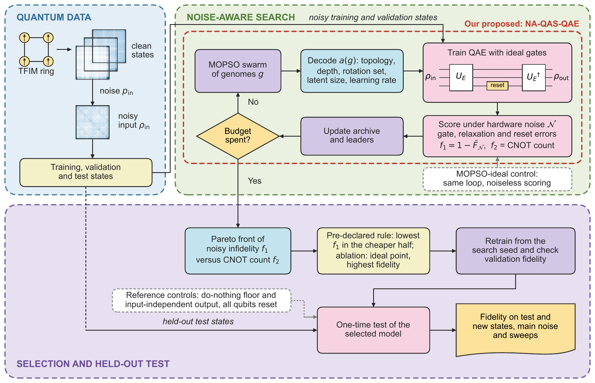</p>

**Figure 1.** Workflow: quantum data, the noise-aware swarm loop, selection, held-out test and reference controls. [PDF](figures/fig1_framework.pdf)

<p align="center">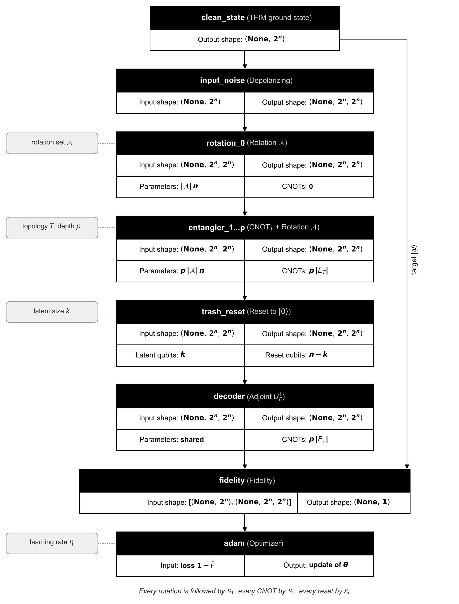</p>

**Figure 2.** Layer graph of the autoencoder and the genes that the search sets. [PDF](figures/fig2_qae_architecture.pdf)

<p align="center">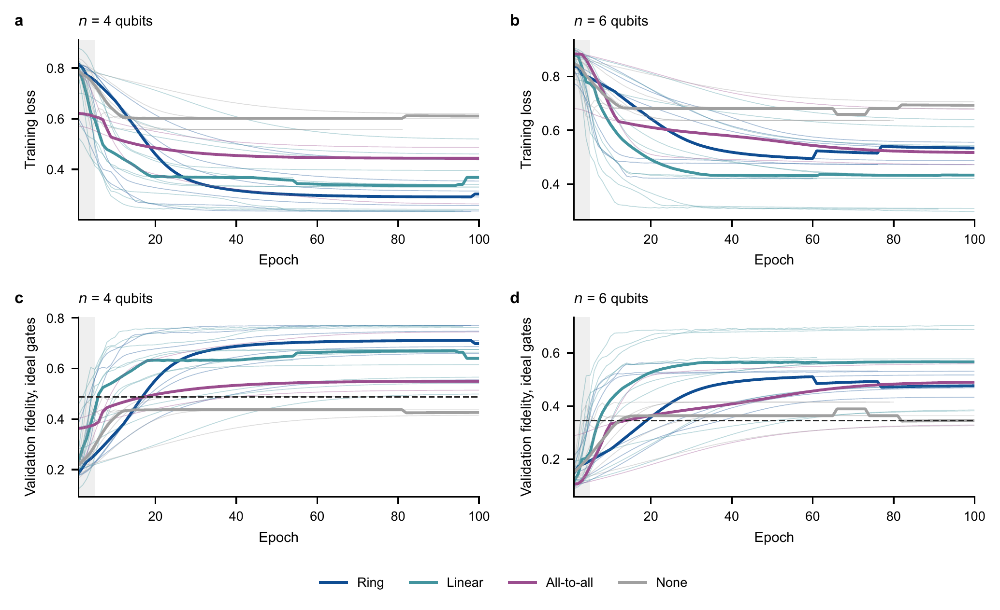</p>

**Figure 3.** Loss and validation fidelity per epoch in the pilot runs. [PDF](figures/fig3_training_dynamics.pdf)

<p align="center">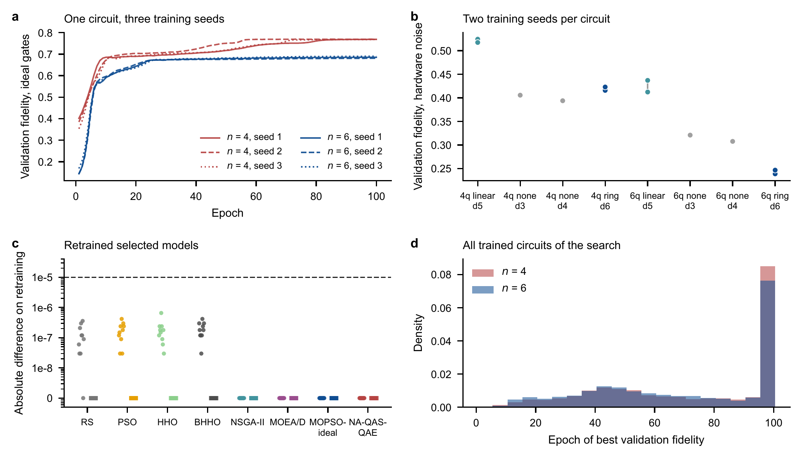</p>

**Figure 4.** Spread over training seeds and reproduction of the selected models. [PDF](figures/fig4_training_reproducibility.pdf)

<p align="center">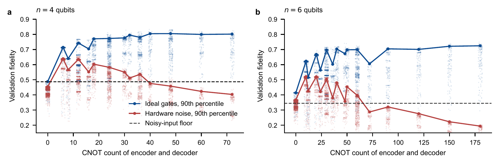</p>

**Figure 5.** Noisy validation fidelity against the CNOT count of every evaluated circuit. [PDF](figures/fig5_cnot_cost.pdf)

<p align="center">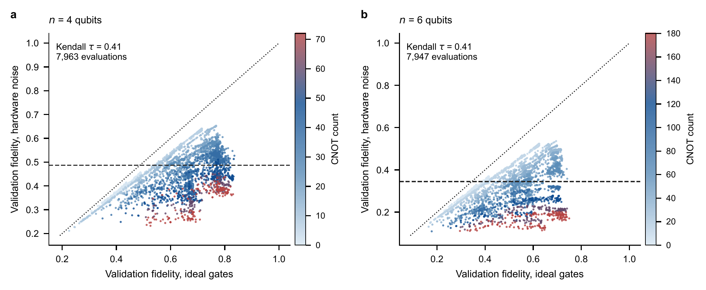</p>

**Figure 6.** Ideal against noisy validation fidelity for all evaluated circuits. [PDF](figures/fig6_rank_transfer.pdf)

<p align="center">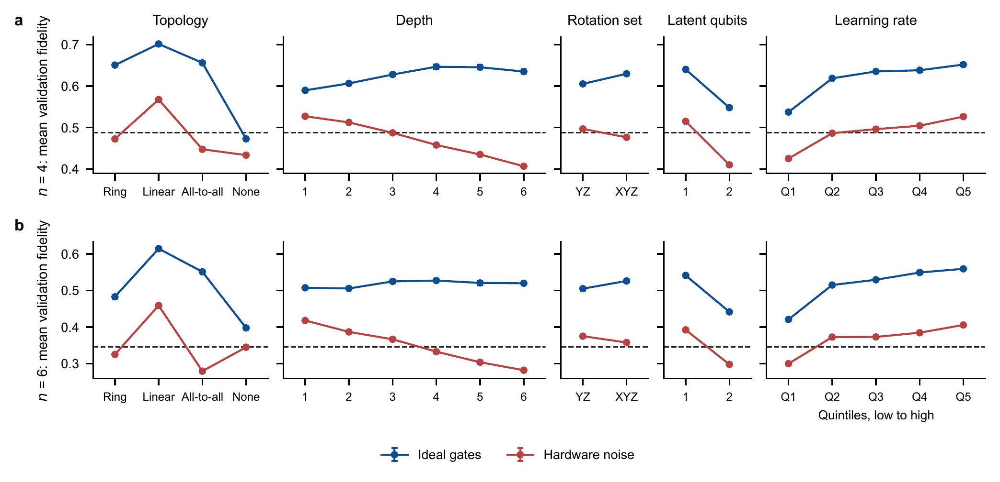</p>

**Figure 7.** Mean validation fidelity for each value of each gene. [PDF](figures/fig7_gene_main_effects.pdf)

<p align="center">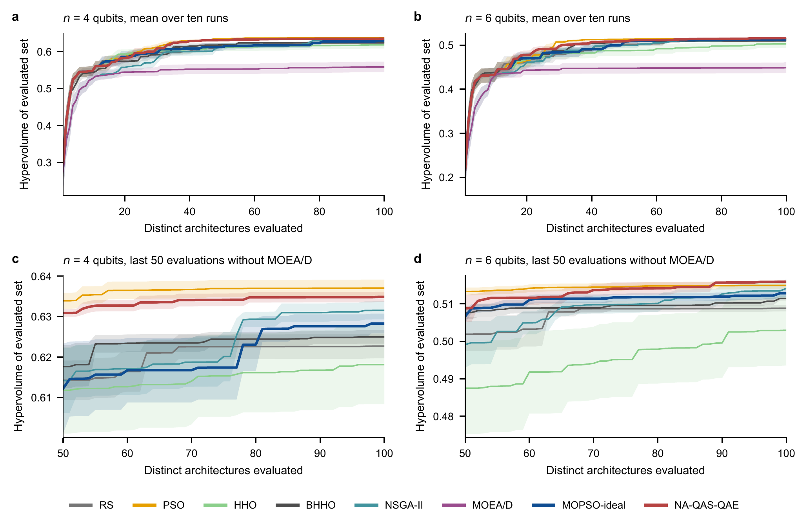</p>

**Figure 8.** Hypervolume as the evaluation budget is spent. [PDF](figures/fig8_hv_convergence.pdf)

<p align="center">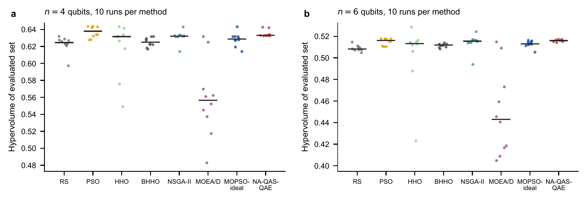</p>

**Figure 9.** Hypervolume of every run of every method. [PDF](figures/fig9_hypervolume.pdf)

<p align="center">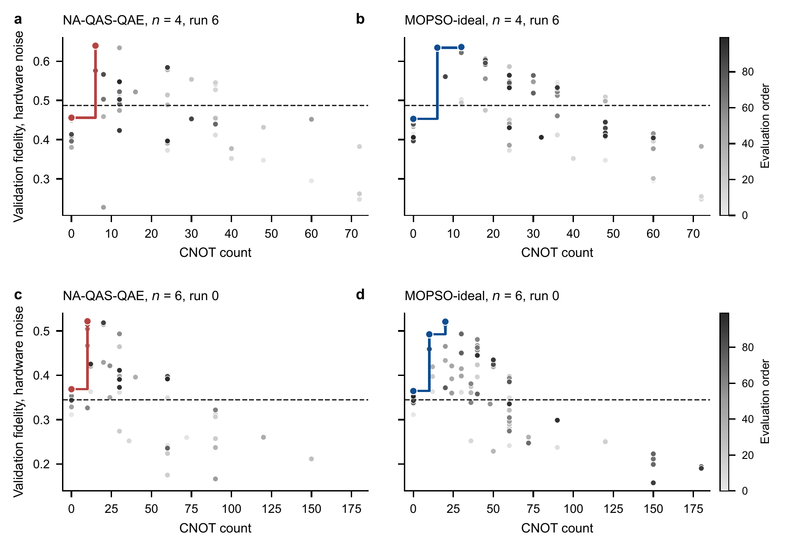</p>

**Figure 10.** Evaluated circuits and noisy front of one run of each swarm variant. [PDF](figures/fig10_search_trajectories.pdf)

<p align="center">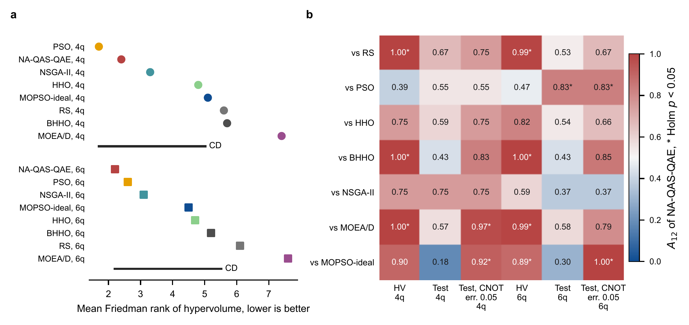</p>

**Figure 11.** Friedman ranks and pairwise effect sizes. [PDF](figures/fig11_statistics.pdf)

<p align="center">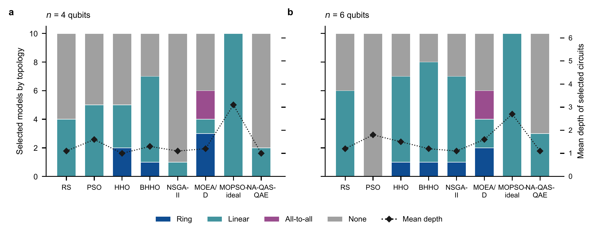</p>

**Figure 12.** Topology and depth of the selected models. [PDF](figures/fig12_selected_architectures.pdf)

<p align="center">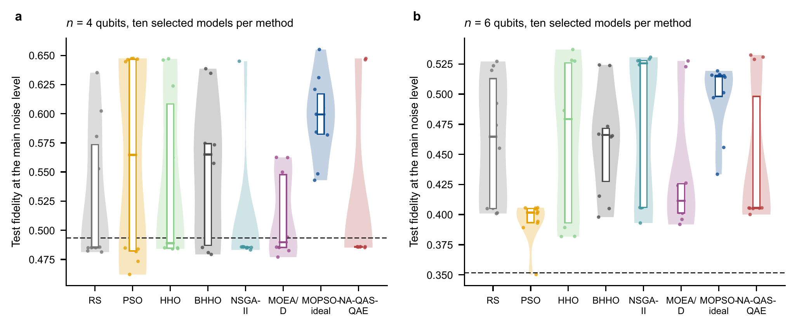</p>

**Figure 13.** Distribution of the held-out fidelity at the main noise level. [PDF](figures/fig13_test_distribution.pdf)

<p align="center">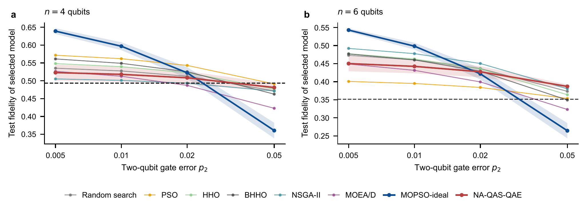</p>

**Figure 14.** Held-out fidelity as the two-qubit error rises. [PDF](figures/fig14_noise_sweep.pdf)

<p align="center">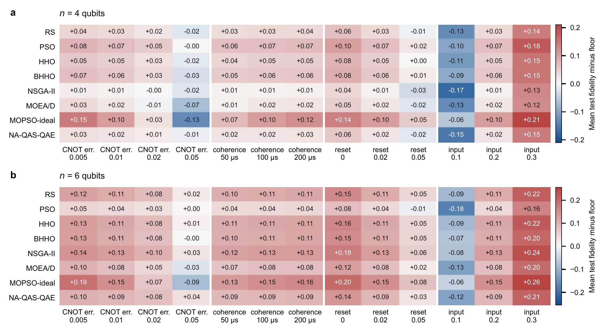</p>

**Figure 15.** Mean held-out fidelity minus the floor for every noise condition. [PDF](figures/fig15_noise_heatmap.pdf)

## Reproducing

```bash
pip install -r requirements.txt
cd code
python -m pytest -q tests                      # unit tests, about one minute on one CPU
cd ..
python code/analysis/final_report_v2.py         # regenerate the summary files from the records
python code/analysis/rev2_report.py
python code/analysis/hwreal_report.py
python code/analysis/capacity_report.py
python code/analysis/revision_report.py
python code/analysis/ablation_report.py
python code/analysis/paper_numbers.py
```

The analysis scripts read only the records in `results/` and reproduce the summary JSON files exactly.
Re-running an experiment from scratch uses the scripts in `code/experiments/`, for example

```bash
python code/experiments/search_v2.py 4 namopso 0 out/       # one search run, four qubits, seed 0
```

A full search run takes roughly 0.2 to 1.2 CPU hours depending on the method and the problem size.

## License

Code: MIT License, see `LICENSE`. All data are simulated by the code in this repository.
